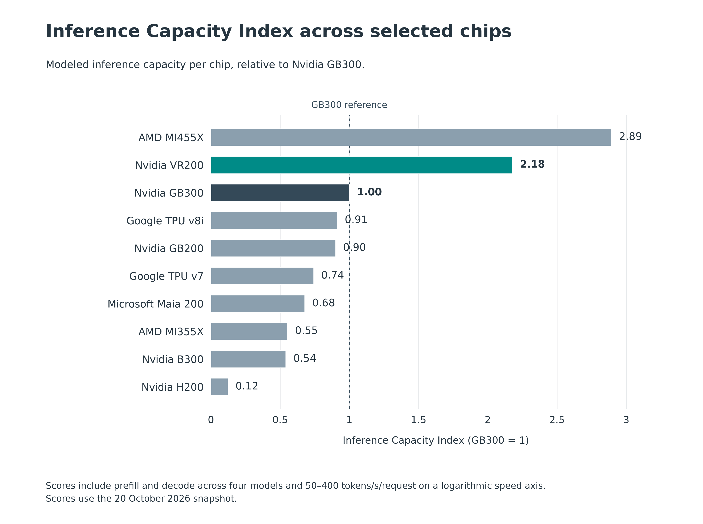
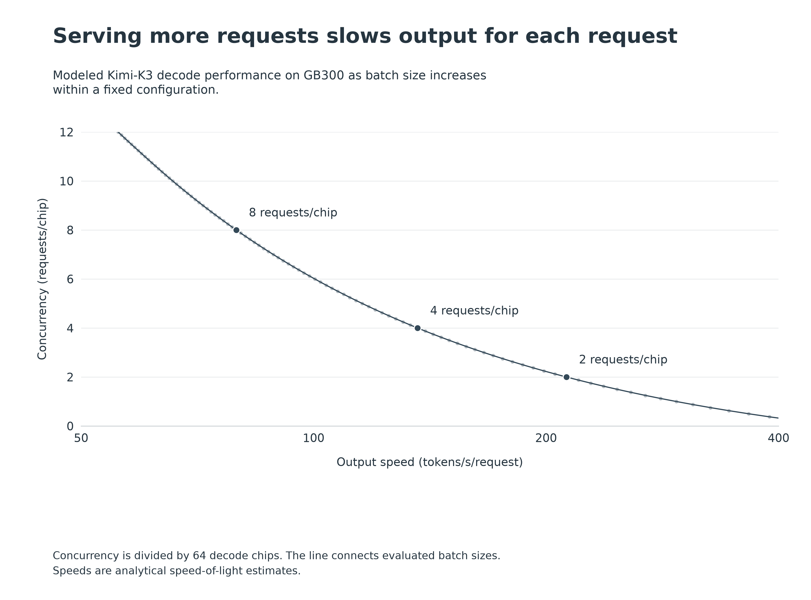
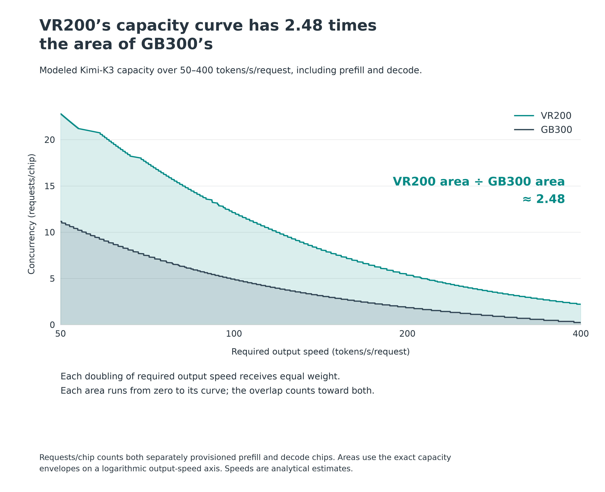
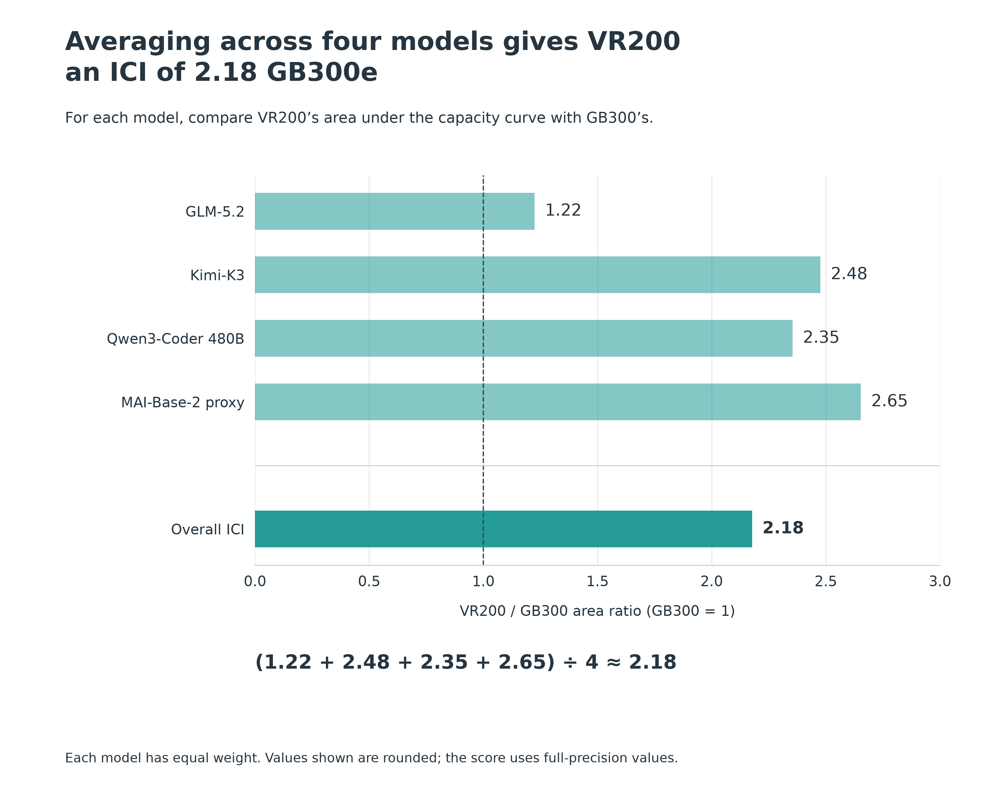

# Launch report figures and reproduction

**Report calculation snapshot: 20 October 2026 Rubin revision of ICI v1.**
Documentation and figure wording updated 28 October 2026. GB300 = 1;
VR200 = 2.177366570368923. The report's publication URL will be linked here
when available; no private draft link is needed to use this repository.

For intuition, read the short launch report once published. For official
scores use the [ML Hardware Data Explorer](https://epoch.ai/data/machine-learning-hardware).
For the complete calculation, start with the [Markdown methodology](../METHODOLOGY.md).
The [snapshot guide](../SNAPSHOTS.md) separates report results from historical
reproduction and standalone experiments.

## Reproduce the report snapshot

From the repository root:

```bash
# Offline score reconstruction. Standard-library Python only.
python3 reproduce.py rubin-update

# Figures only need matplotlib, not AISimulate, a GPU or model weights.
# Use the existing environment if available, or a small plotting environment:
python3 -m venv .venv-figures
.venv-figures/bin/pip install matplotlib==3.11.2
.venv-figures/bin/python studies/report_figures.py
```

The figure script verifies both reference manifests, rebuilds the revised
scores into `results/report-figures/scores/`, checks fixed-layout data against
matching saved frontier points, and writes four PNGs, editable SVGs and CSVs.
It also writes `provenance.json` with input/script/output hashes and plotting
versions. The checked-in [figures](figures/) are immediately viewable on GitHub.
No credentials or private trace database are required. Installation needs
package-index access; rendering and saved-score reconstruction work offline.

The renderer's numerical inputs determine the displayed scores and exported
CSV values together. The fixed Figure 2 candidate export is separately hashed
because the optimal frontier does not retain every nonwinning batch from that
one layout. It contains simulation results only. Matplotlib/font/platform
versions can change image bytes; numerical agreement is the reproducibility
criterion, not byte-identical PNGs across platforms.

## Figure reproduction map

All four figures use `python studies/report_figures.py`; paths below are
relative to the repository root. The renderer does not modify frozen inputs.

| Report figure | Inputs | CSV in `results/report-figures/` | Image stem in the same directory |
| --- | --- | --- | --- |
| 1: ten selected accelerators | Base `reference/2026-10-15/` plus `reference/2026-10-20-rubin/`; ten named profiles selected from rebuilt index | `figure_1_selected_chips.csv` | `figure_1_selected_chips` |
| 2: concurrency/output-speed tradeoff | `docs/report/inputs/kimi_gb300_fixed_layout.csv`, its provenance, unchanged GB300 profile | `figure_2_decode_tradeoff.csv` | `figure_2_decode_tradeoff` |
| 3: Kimi area comparison | Same revised snapshot as Figure 1; Kimi decode frontiers and optimized prefill rates | `figure_3_capacity_curves.csv` | `figure_3_model_areas` |
| 4: averaging models | Exact per-model log areas from the same inputs as Figure 3 | `figure_4_model_ratios.csv` | `figure_4_model_average` |

Figure 2 counts **decode chips only**. Figures 1, 3 and 4 include separately
provisioned prefill. Figure 3's sampled CSV describes the visual curves;
the exact score is integrated from every saved breakpoint, not from the
sampled display grid. Figure 4 exports the exact areas as well as their ratios.
The same script holds titles, units and numerical annotations together.

The report's **Figure 5** is a separately sourced InferenceX chart viewed on
27 October 2026, including an official Rubin preview. It is not generated by
this repository, and a live InferenceX URL does not freeze its historical
observations. Its source is [InferenceX Kimi-K3](https://inferencex.semianalysis.com/inference/kimi-k3).
The [19 October validation study](../research/inferencex-validation/README.md)
is a different saved benchmark snapshot; it must not be described as an exact
reproduction of that screenshot. To reproduce Figure 5 numerically in a future
release, archive the chart's exact public observations and metadata first.

## Figure previews



*Figure 1. Modeled inference capacity for ten selected chips, in GB300 equivalents.*



*Figure 2. Kimi-K3 on GB300, varying batch within TP8 DP8 DCP8 EP64 ETP1 PP1.
Concurrency is divided by 64 decode chips.*



*Figure 3. Shading marks each capacity curve's area over 50–400 tokens/s/request.
The ratio is 2.48 for Kimi, not VR200's overall ICI.*



*Figure 4. Equal averaging gives VR200 2.18 GB300e.*

## Validation and interpretation

The report's measured chart supports broad hardware ordering. The dedicated
[validation study](../research/inferencex-validation/README.md#what-the-comparison-establishes)
asks the narrower question of numerical agreement under stated scenarios.
Its five-point Kimi/GB300 result is about 12% average absolute throughput
difference with both modeled phases at 50% of SOL speed. It does not establish
12% accuracy across the index, across hardware, or for the report's newer
benchmark chart. The validation retains layout, workload, precision and
sampling limitations. None of its efficiency scenarios discount the ICI scores.
