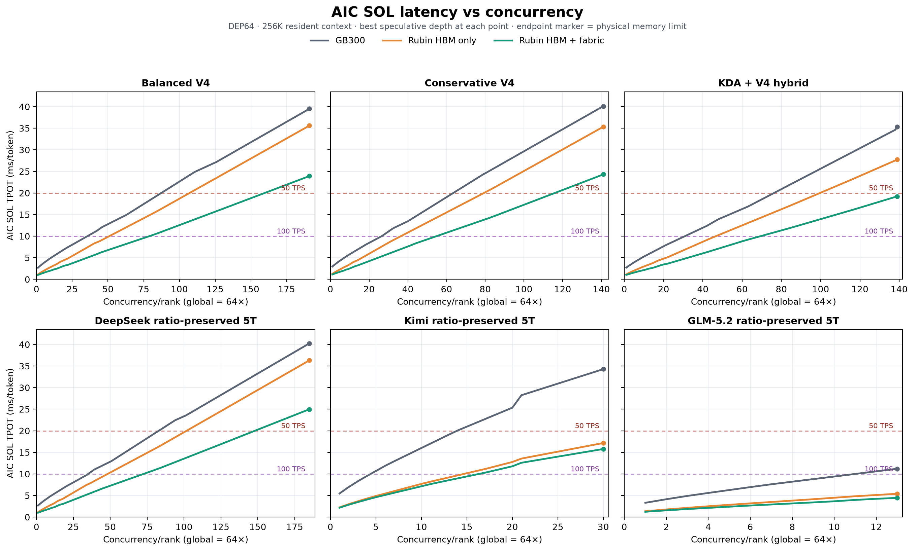

> Historical exploratory study. See [scope and snapshot notes](../README.md) before using these projections.

# Latency-versus-concurrency curves

All curves are DEP64 decode-only projections with a resident 256K context and no prefill. Every integer c/r through the physical memory boundary is directly represented. The selected point at each c/r is the fastest memory-fitting speculative depth under the common DSpark AL assumption, including no-spec fallback.

These figures contain raw AIC SOL TPOT only. No achievable-performance efficiency multiplier is applied.

## SOL hardware comparison

## Rubin HBM+fabric threshold summary

Each cell is maximum c/r; global concurrency is c/r × 64.

| Configuration | Target | GB300 | Rubin HBM | Rubin HBM+fabric | Physical max on Rubin |
| --- | ---: | ---: | ---: | ---: | ---: |
| Balanced V4 | 50 | 87 | 107 | 159 | 191 |
| Balanced V4 | 100 | 35 | 50 | 79 | 191 |
| Conservative V4 | 50 | 63 | 79 | 115 | 141 |
| Conservative V4 | 100 | 26 | 36 | 54 | 141 |
| KDA + V4 hybrid | 50 | 76 | 99 | 139 | 139 |
| KDA + V4 hybrid | 100 | 30 | 46 | 69 | 139 |

## Reading the curves

- The 10-ms line is 100 TPS/user; the 20-ms line is 50 TPS/user.
- A line crossing a threshold gives the maximum c/r at that achieved rate.
- Endpoint markers are hard modeled memory boundaries, not recommended production allocations.
- Kinks can occur when AIC changes the fastest speculative depth or a kernel regime changes.
- These are SOL latency curves, not achieved serving latency forecasts.

Raw points are in `latency_concurrency_curves.csv`; SVG versions are available for lossless inspection.
